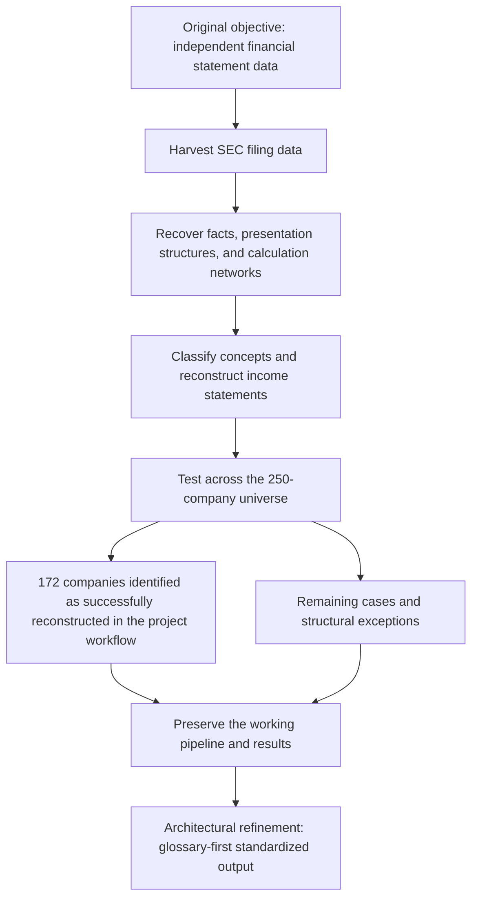
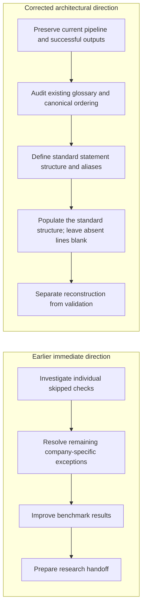
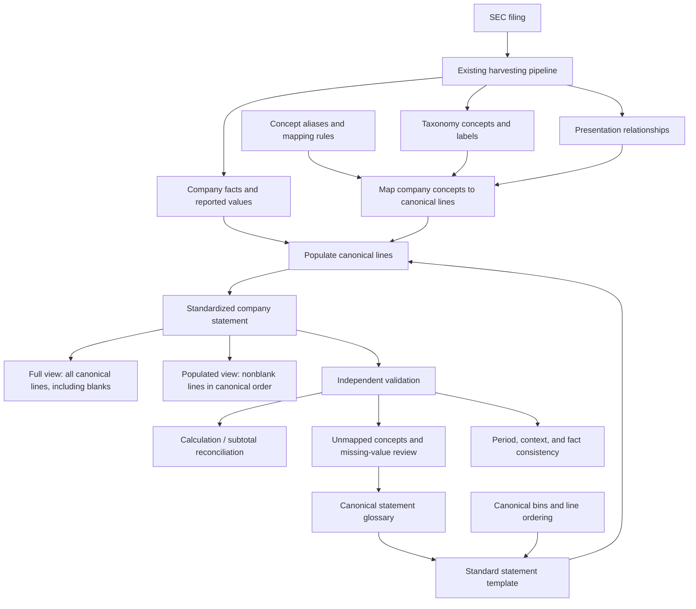

# XBRL Research — Architecture and Direction

**Purpose:** Preserve the project-level design, explain how the current work fits together, and define the next architectural steps.

**Scope:** Income-statement reconstruction first. Preserve the existing harvesting, reconstruction, and benchmark work. This is an evolution of the current pipeline, not a restart.

---

## 1. From the original objective to the current position

The 172-company figure records the project's stated successful reconstruction milestone. It is not interchangeable with a particular benchmark status count such as `RECONCILES`.

## 2. Earlier direction versus corrected direction

Company-specific exceptions remain useful research evidence, but they must not dictate the standard statement structure. A missing optional line or calculation component is not automatically a reconstruction failure.

## 3. Target architecture

## 4. Design principles

1. **One canonical structure:** Every company uses the same statement glossary, bins, and ordering.
2. **Absence means blank:** If a company does not report a canonical line, retain the line in the full view and leave its value blank. Do not manufacture zeroes.
3. **Aliases map to canonical lines:** Different reported concepts can populate the same standard line when evidence supports the mapping.
4. **Unknown concepts are captured:** Unmapped reported concepts are retained for review and possible glossary expansion, not silently discarded.
5. **Two display modes:** Show all canonical lines, or only populated lines while retaining canonical order and grouping.
6. **Validation is separate:** Calculation-linkbase coverage and subtotal reconciliation assess arithmetic relationships; they do not define the canonical statement or determine whether a reported line belongs in it.
7. **Preserve working results:** Improve the architecture without discarding the existing harvesting pipeline, benchmark, or successful company reconstructions.

## 5. Implementation sequence

1. Audit the existing glossary, canonical ordering, mapping logic, reconstruction outputs, and validation checks.
2. Define and verify the canonical income-statement bins, line order, and alias rules using existing research artifacts.
3. Adapt reconstruction output to populate the canonical structure, retaining blank lines and capturing unmapped concepts.
4. Separate statement coverage and mapping diagnostics from calculation reconciliation.
5. Test against existing successful companies and varied detailed examples; verify no regression.
6. Reassess the full benchmark using the standardized output and clearly defined measures.

## 6. Current status and boundaries

This document records the intended architecture and direction. It does not assert that every implementation component is already in place or that the target design has been validated across all companies.

The existing code, glossary, generated research outputs, and acceptance criteria must be audited before implementation changes are selected.

**Canonical detailed findings:** `Dev_tools/xbrl/FINDINGS_consolidated.md`

**Acceptance criteria:** `Dev_tools/XBRL_ACCEPTANCE_MATRIX.md`
